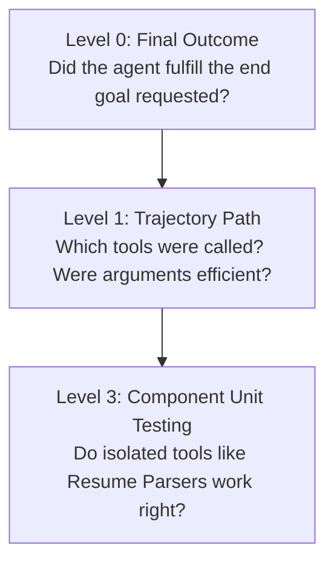
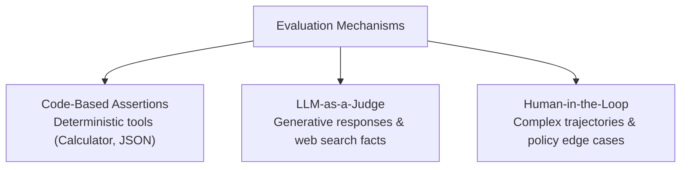

# Enough For Any AI Agent Evaluation Interview | AI Engineer Series

> **Lecturer:** Pratyush  
> **Source:** [YouTube Lecture](http://www.youtube.com/watch?v=teKavsgzpyo)

---

## 1. Overview & Core Conceptual Framework

Evaluating AI agents is one of the most heavily tested domains in AI engineering interviews. Interviewers rarely ask candidates to write complete evaluation suites live on a whiteboard; instead, they assess whether the candidate understands the fundamental challenges, multi-level frameworks, and benchmark datasets required for non-deterministic AI testing.

This lecture breaks down AI Agent Evaluation into **5 essential interview questions**:

1. **Why is evaluating AI Agents hard compared to traditional software testing?**
2. **What are the different levels of AI Agent Evaluation?**
3. **How do you evaluate execution paths (trajectories) versus final outcomes?**
4. **Who or what performs the evaluation (Code vs. LLM-as-a-Judge vs. Human)?**
5. **What is a Golden Dataset, and how is it constructed?**

---

## 2. Why AI Agent Evaluation is Hard

### 2.1 Traditional Software vs. AI Agent Architecture

| Feature | Traditional Software Testing (e.g., Amazon / PhonePe) | AI Agent Evaluation |
| :--- | :--- | :--- |
| **Execution Nature** | **Deterministic** | **Non-Deterministic** |
| **Output Behavior** | Fixed, repeatable, binary (Pass/Fail). | Generative, varying phrasing across identical calls. |
| **Correctness Path** | Single predefined expected state. | Multiple valid outputs or multiple execution paths. |
| **Testing Paradigm** | Unit Testing, Integration Testing assertions. | Multi-Level Trajectory & LLM-as-a-Judge benchmarks. |

### 2.2 The Determinism Gap

* **Deterministic Software Example (PhonePe/Amazon):**
  * If User A sends ₹100 to User B, there is exactly one correct outcome: User A's balance decreases by ₹100 and User B's balance increases by ₹100. Any other behavior (debit without credit, double debit) is explicitly an error.

* **Non-Deterministic AI Agent Example:**
  * Asking an LLM *"Who is Pratyush Narayan?"* in two separate browser tabs yields two different text responses:
    * **Tab 1:** *"Pratyush Narayan is a Software Engineer at Akamai and a YouTube educator."*
    * **Tab 2:** *"Pratyush Narayan is an AI Content Creator with 250k Instagram followers."*

* **The Core Evaluation Challenge:**
  * Both answers are factually correct, yet neither is identical line-by-line. Standard string-matching or hardcoded assertions in traditional software testing fail when evaluating non-deterministic generative outputs.

---

## 3. The 3 Levels of AI Agent Evaluation

AI agent testing must evaluate not only the final answer, but also the intermediate decisions, tool selections, and component reliability.



### 3.1 Level 0: Final Outcome Check

* **Objective:** Validates whether the agent successfully accomplished the end goal, regardless of how it arrived there.
* **Example Scenario:** Prompt = *"Book a 3-star hotel in a city with a beach."*
* **Pass Condition:** A 3-star hotel is booked in a coastal beach city (e.g., Chennai).
* **Fail Conditions:**
  * Booked a 3-star hotel in Patna (Patna has no beach).
  * Booked a 5-star hotel in Chennai (wrong star rating).
  * Hotel booking failed entirely.

---

### 3.2 Level 1: Trajectory Evaluation (Execution Path & Efficiency)

* **Objective:** Evaluates the step-by-step path, tool choices, arguments, and loop efficiency used to reach the final answer.
* **Why Outcome Testing Is Not Enough:** An agent might achieve Level 0 pass status through an extremely inefficient, costly, or brute-force trajectory.

#### Trajectory Comparison Example

To book a 3-star hotel in a beach city, the agent could follow two distinct trajectories:

1. **Trajectory 1 (Optimal Path):**
   * **Step 1:** Call `find_beach_cities` tool $\rightarrow$ returns ~3,000 coastal cities worldwide.
   * **Step 2:** Select a coastal city and call `search_3star_hotels(city)` $\rightarrow$ books hotel.

2. **Trajectory 2 (Sub-Optimal / Brute-Force Path):**
   * **Step 1:** Search for **all** 3-star hotels across the entire globe $\rightarrow$ returns ~3,000,000 hotels.
   * **Step 2:** Filter all 3 million hotels to find which ones belong to beach cities $\rightarrow$ books hotel.

#### Common Trajectory Failures Detected in Level 1

* **Redundant Tool Calls:** Calling `find_beach_cities` 3 times consecutively before moving to hotel booking.
* **Infinite Loops:** Re-querying the same search tool endlessly due to prompt ambiguity, burning tokens until execution hits maximum iteration limits.
* **Excessive API Cost:** Sub-optimal trajectories exponentially increase input/output token usage and tool API costs.

---

### 3.3 Level 3: Component / Unit Testing

* **Objective:** Isolates and tests complex individual tools or sub-components independently from the main LLM orchestrator.
* **Simple vs. Complex Tools:**
  * **Simple Tool (e.g., Calculator):** High determinism; simple math evaluation.
  * **Complex Tool (e.g., Resume Parser):** Takes a PDF resume, extracts candidate details, and transforms text into structured JSON.
* **Component Testing Procedure:** Feed sample resumes directly into the `resume_parser` function and verify if it outputs valid, complete JSON (extracting `name`, `email`, `experience` correctly) before integrating it into the full agent loop.

---

## 4. Evaluation Execution Mechanisms: Who Performs the Test?

Because AI agent tasks range from deterministic arithmetic to open-ended research, evaluation responsibilities are divided among three mechanisms:



1. **Code-Based Deterministic Assertions:**
   * Used when expected outputs are exact (e.g., Calculator tool returning `2 + 2 = 4`, or verifying JSON schema syntax).

2. **LLM-as-a-Judge:**
   * An independent, high-reasoning evaluator LLM assesses the factual accuracy, relevance, and quality of generative outputs or search summaries where code assertions cannot run.

3. **Human-in-the-Loop Review:**
   * Human engineers review complex execution logs, evaluate subtle trajectory efficiency, and audit edge cases.

---

## 5. The Golden Dataset

### 5.1 Definition & Purpose

A **Golden Dataset** is a curated, benchmark reference dataset of representative test scenarios used to evaluate an AI agent systematically before production deployment.

### 5.2 Size Guidelines

* **Simple / Internal Tool:** 2 – 10 test cases.
* **Customer Support Agent (e.g., Zomato Support Bot):** 1,000+ test cases covering refunds, cancellations, and escalations.
* **Enterprise System (e.g., Google Search/Agent):** 100,000+ comprehensive test cases.

### 5.3 The 4 Core Schema Fields of a Golden Dataset Item

```json
{
  "input": "User query or scenario prompt",
  "expected_tools": ["List of tools the agent should invoke"],
  "expected_arguments": {
    "key": "Parameters passed into tools"
  },
  "success_check": "Level 0 outcome criteria to verify success"
}
```

#### Real-World Example (Zomato Refund Request)

* **Input (Scenario):** User prompt: *"The food delivered was cold and damaged. Give me a full ₹300 refund."*
* **Expected Tools:** `["call_human_support"]` (Policy dictates the AI agent cannot issue refunds autonomously without human sign-off).
* **Expected Arguments:** `{"order_id": "12345", "issue": "damaged_food", "requested_amount": 300}`
* **Success Check:** The agent escalates to human support with correct parameters and informs the user that the request is under review.

---

## ⚡ Quick Revision Summary

1. AI Agent evaluation is difficult because LLM outputs are non-deterministic, unlike traditional software.
2. Traditional software testing relies on binary pass/fail assertions on fixed outputs.
3. Level 0 evaluation verifies whether the final outcome/goal was achieved.
4. Level 1 evaluation audits the trajectory (path, tool calls, arguments, and loop efficiency).
5. Trajectory testing prevents brute-force paths, infinite loops, and token-cost spikes.
6. Level 3 evaluation performs unit testing on isolated complex tools (e.g., Resume Parser).
7. Deterministic tools (e.g., Calculator) are evaluated using code-based assertions.
8. Generative text outputs are evaluated using **LLM-as-a-Judge**.
9. Complex execution trajectories and edge cases are audited via **Human-in-the-Loop** review.
10. A Golden Dataset consists of 4 schema fields: `input`, `expected_tools`, `expected_arguments`, and `success_check`.

---

## ❓ Questions Raised by Lecturer

* **Q: Why can't traditional QA / Software Testers evaluate AI Agents using existing automation tools?**  
  **A:** Because traditional software is deterministic with fixed expected outputs, whereas AI agents produce generative, non-deterministic responses across identical prompts.

* **Q: Is achieving a Level 0 (Final Outcome) Pass sufficient to deploy an AI Agent?**  
  **A:** No. An agent can pass Level 0 through an inefficient or dangerous Level 1 trajectory (e.g., calling tools in infinite loops or running brute-force searches that burn API credits).

---

## 📖 Definitions (from Video Only)

* **Non-Deterministic Output:** Generative text responses that vary in phrasing across calls despite identical user inputs.
* **Level 0 Evaluation:** Testing whether the final outcome or user goal was fulfilled.
* **Level 1 Trajectory Evaluation:** Auditing the sequence of tool calls, arguments, and path efficiency used to reach an outcome.
* **Level 3 Component Testing:** Isolating and unit-testing a single complex tool independently from the LLM workflow.
* **LLM-as-a-Judge:** Using a separate evaluator LLM to grade the quality, accuracy, and relevance of generative outputs.
* **Golden Dataset:** A benchmark reference dataset containing inputs, expected tools, expected arguments, and success criteria for systematic agent evaluation.