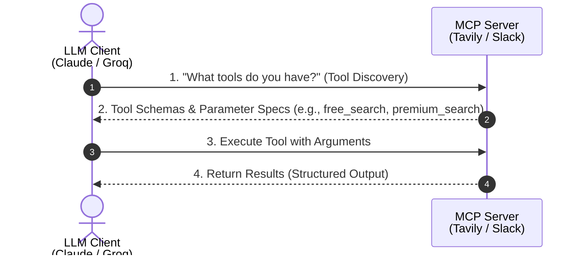

# 🌐 Model Context Protocol (MCP)

> **Course:** AI Engineer Course  
> **Topic:** Best Explanation Of MCP On The Internet  
> **Lecturer:** Pratyush  
> **Source:** [Watch on YouTube](http://www.youtube.com/watch?v=XstMQwKpxcA)

---

## 📑 Table of Contents

- [1. Introduction & The Core Analogy](#1-introduction--the-core-analogy)
  - [1.1 The Household Helper Story (Language Barrier Analogy)](#11-the-household-helper-story-language-barrier-analogy)
  - [1.2 Analogy Mapping to AI Systems](#12-analogy-mapping-to-ai-systems)
- [2. What is Model Context Protocol (MCP)?](#2-what-is-model-context-protocol-mcp)
- [3. The Two Major Problems MCP Solves](#3-the-two-major-problems-mcp-solves)
  - [3.1 Problem 1: Exponential Code Expansion (Codebase Bloat)](#31-problem-1-exponential-code-expansion-codebase-bloat)
  - [3.2 Problem 2: Fragile Dependencies & API Breaking Changes](#32-problem-2-fragile-dependencies--api-breaking-changes)
- [4. How MCP Works (Architecture & Execution Flow)](#4-how-mcp-works-architecture--execution-flow)
  - [4.1 Concept of Protocol](#41-concept-of-protocol)
  - [4.2 The MCP Server Architecture](#42-the-mcp-server-architecture)
  - [4.3 Key Advantage](#43-key-advantage)
- [5. The Restaurant Ordering Analogy](#5-the-restaurant-ordering-analogy)
- [6. Industry Standard & Adoption](#6-industry-standard--adoption)
- [7. ⚡ Quick Revision Summary](#-quick-revision-summary)
- [8. ❓ Questions Raised by Lecturer](#-questions-raised-by-lecturer)
- [9. 📖 Definitions (From Video Only)](#-definitions-from-video-only)
- [10. 💡 Examples Used in Video](#-examples-used-in-video)

---

## 1. Introduction & The Core Analogy

### 1.1 The Household Helper Story (Language Barrier Analogy)

#### ❌ The Problem
A person named Pratyush tries hiring household workers:
* **Driver Agency** $\rightarrow$ Driver speaks **French**. To hire her, Pratyush must learn French.
* **Cook Agency** $\rightarrow$ Cook speaks **Japanese**. To hire him, Pratyush must learn Japanese.
* **Cleaner Agency** $\rightarrow$ Cleaner speaks **German**. To hire him, Pratyush must learn German.
* **Replacement Cook** $\rightarrow$ Later, the cook is replaced by a new worker who speaks **Chinese**, requiring Pratyush to learn Chinese.

#### ✅ The Solution
A wise person intervenes and establishes a universal standard: **English**.
* Every worker learns English.
* The employer communicates seamlessly with all workers without learning multiple languages.

---

### 1.2 Analogy Mapping to AI Systems

| Story Element | AI Equivalent | Details / Examples |
| :--- | :--- | :--- |
| **The Employer** (Pratyush) | **LLM / AI Model Client** | Claude, ChatGPT, Gemini, Groq |
| **The Workers** (Driver, Cook, Cleaner) | **External Tools & Services** | GitHub, Slack, Google Drive, Tavily, Gmail |
| **The Custom Languages** (French, Japanese, German) | **Custom API Syntaxes** | Custom, non-standard API syntaxes for different third-party tools |
| **The Universal Language** (English) | **Model Context Protocol (MCP)** | Open, standardized protocol enabling seamless communication |
| **The Wise Person** | **Anthropic** | Created MCP as an open standard in late 2024 |

---

## 2. What is Model Context Protocol (MCP)?

### 2.1 Definition
* **MCP** stands for **Model Context Protocol**.
* Created by **Anthropic** in 2024 as an open, standardized protocol that defines how Large Language Models (LLMs) discover, query, and execute external tools and data sources.

---

## 3. The Two Major Problems MCP Solves

### 3.1 Problem 1: Exponential Code Expansion (Codebase Bloat)
* **The Issue:** Without a unified protocol, AI model developers (e.g., Anthropic building Claude) have to manually write and maintain custom Python/API wrapper functions for millions of external web tools (GitHub, Slack, Google Drive, Gmail, Tavily).
* **The Consequence:** Writing bespoke integration code for thousands of tools adds **millions of lines of boilerplate code** to the LLM application codebase.

### 3.2 Problem 2: Fragile Dependencies & API Breaking Changes
* **The Issue:** If an external tool vendor (e.g., Tavily Search) changes its API parameter signature (e.g., changing required inputs from 3 arguments to 2 arguments), the LLM application breaks instantly.
* **The Consequence:** Without MCP, the LLM developer must rewrite their internal integration functions and release a new model/software version (e.g., updating Claude Opus 5.5 to Opus 5.6) just to adapt to a third-party API update.

---

## 4. How MCP Works (Architecture & Execution Flow)

### 4.1 Concept of Protocol
> [!NOTE]
> A **Protocol** is a standard set of rules governing interactions between entities (e.g., VIP diplomatic protocols, college rules).

### 4.2 The MCP Server Architecture
Tool creators (Tavily, Gmail, Slack, GitHub) package their capabilities inside an **MCP Server**.

#### Interaction Sequence Diagram



```text
┌─────────────────┐      1. "What tools do you have?"     ┌──────────────────┐
│                 ├──────────────────────────────────────►│                  │
│   LLM Client    │                                       │    MCP Server    │
│ (Claude/Groq)   │◄──────────────────────────────────────┤ (Tavily/Slack)   │
│                 │   2. Tool Schemas & Parameter Specs   │                  │
│                 │                                       │                  │
│                 ├──────────────────────────────────────►│                  │
│                 │     3. Execute Tool with Arguments    │                  │
│                 │◄──────────────────────────────────────┤                  │
└─────────────────┘           4. Return Results           └──────────────────┘
```

#### Step-by-Step Flow:
1. **Tool Discovery:** The LLM queries the MCP Server: *"What tools are available?"*
2. **Schema Response:** The MCP Server responds with a dynamic list of available functions (e.g., `free_search`, `premium_search`) along with their input parameter schemas.
3. **Execution Request:** The LLM passes the required arguments to the MCP Server according to the discovered schema.
4. **Data Return:** The MCP Server executes the tool locally and returns the structured output back to the LLM.

### 4.3 Key Advantage
* **Zero Hardcoding:** The LLM never hardcodes third-party API syntaxes.
* **Dynamic Adaptation:** When a tool provider changes or adds functions, they simply update their own **MCP Server**.
* **Seamless Updates:** The LLM discovers the updated tools automatically on the next query without model code changes.

---

## 5. The Restaurant Ordering Analogy

### 🍽️ The Universal Restaurant Protocol
Across millions of hotels and restaurants globally (KFC, Domino's, local diners), food ordering follows the exact same 3-step protocol:

```text
[ Step 1: Ask for Menu ]  ──►  [ Step 2: Place an Order ]  ──►  [ Step 3: Pay the Bill ]
```

1. **Ask for the Menu**
2. **Place an order** for the selected dish
3. **Pay the bill**

#### Why This Works:
* No restaurant forces customers to learn specialized routines (e.g., dancing or washing dishes) before ordering.
* Because the protocol is standardized, learning how to order at one restaurant allows a person to order at any restaurant in the world without taking a special course.
* **MCP is the universal ordering protocol for LLMs and tools.**

---

## 6. Industry Standard & Adoption

* **Universal Adoption:** MCP has become the universal industry standard adopted across major LLM providers and tool developers.
* **Scalability Threshold:** Custom integration functions work fine for small local scripts, but as system scale and tool counts grow, implementing MCP becomes essential.

---

## 7. ⚡ Quick Revision Summary

1. **MCP** stands for **Model Context Protocol**, created by **Anthropic** in 2024.
2. MCP establishes an open, standard language/protocol for LLMs to interact with third-party tools.
3. Without MCP, model developers must manually write millions of lines of custom API wrapper code.
4. Third-party API changes break non-MCP integrations, requiring model software updates.
5. In an MCP system, tool providers host an **MCP Server** that exposes tools and parameter schemas dynamically.
6. LLMs query MCP Servers to discover tools, send arguments, and receive execution results without hardcoded syntaxes.
7. Updating an MCP Server immediately updates tool availability for all connected LLMs without changing LLM code.
8. Ordering food at a restaurant (Menu $\rightarrow$ Order $\rightarrow$ Pay) is a real-world analogy for standardized protocol interaction.

---

## 8. ❓ Questions Raised by Lecturer

### Q1: Who created MCP, and when?
> **Answer:** Anthropic created the Model Context Protocol (MCP) in 2024 as an open standard.

### Q2: What happens when a tool provider changes their API parameters in a traditional system vs. an MCP system?
> **Answer:**
> * **Traditional System:** The LLM application code breaks and must be updated.
> * **MCP System:** The provider updates their MCP Server, and the LLM dynamically discovers the new schema without any code changes.

---

## 9. 📖 Definitions (From Video Only)

| Term | Definition |
| :--- | :--- |
| **Model Context Protocol (MCP)** | An open standard protocol created by Anthropic that standardizes how LLM clients discover, query, and run external tools and services. |
| **MCP Server** | A server hosted by a tool provider (e.g., Tavily, Slack, Gmail) that encapsulates tools and exposes standard discovery and execution endpoints for LLMs. |
| **Protocol** | A defined, standardized set of rules governing how entities interact with one another. |

---

## 10. 💡 Examples Used in Video

* **Language Barrier Story:** Hiring a French-speaking driver, Japanese-speaking cook, German-speaking cleaner, and Chinese-speaking replacement cook vs. standardizing on English.
* **Restaurant Ordering Protocol:** Universal 3-step order process (Request Menu $\rightarrow$ Place Order $\rightarrow$ Pay Bill) across KFC, Domino's, and local restaurants.
* **Tools & Models:** Claude, ChatGPT, Gemini, Groq, Tavily Search, GitHub, Slack, Gmail, Google Drive.