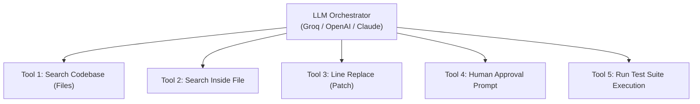

# 🤖 Week 5 Major Project | Design Your Coding Agent

> **Series:** AI Engineer Series  
> **Topic:** Week 5 Major Project | Design Your Coding Agent  
> **Lecturer:** Pratyush (Padho with Pratyush)  
> **Source:** [Watch on YouTube](https://www.youtube.com/watch?v=5mnBxySd_xU)

---

## 📑 Table of Contents

- [1. High-Level Project Purpose](#1-high-level-project-purpose)
  - [1.1 Objective](#11-objective)
  - [1.2 Common Misconception vs. Real-World Architecture](#12-common-misconception-vs-real-world-architecture)
- [2. The Mental Model: The Software Intern Analogy](#2-the-mental-model-the-software-intern-analogy)
- [3. Core Architecture of a Coding Agent](#3-core-architecture-of-a-coding-agent)
  - [3.1 Tool Breakdown](#31-tool-breakdown)
- [4. Execution Workflow & Feedback Loops](#4-execution-workflow--feedback-loops)
- [5. ⚡ Quick Revision Summary](#5--quick-revision-summary)
- [6. ❓ Questions Raised by Lecturer](#6--questions-raised-by-lecturer)
- [7. 📖 Definitions (From Video Only)](#7--definitions-from-video-only)

---

## 1. High-Level Project Purpose

### 1.1 Objective
The major project for Week 5 requires building a custom **Coding Agent** (similar to commercial tools like Claude Code or Codex) from scratch.

### 1.2 Common Misconception vs. Real-World Architecture

* **Misconception:** Developers often assume a coding agent works by taking an entire codebase, copying and pasting all lines into an LLM context window, and asking the model to fix the bug.
* **Why This Fails at Scale:**
  * Works fine for isolated 40-line LeetCode problems.
  * Completely collapses in enterprise codebases (e.g., Amazon scale with 10,000,000+ lines of code, 5,000+ files, and multiple repositories) due to context window limits.
  * Oversaturating the context window causes high latency, token truncation, cost spikes, and loss of historical context.

---

## 2. The Mental Model: The Software Intern Analogy

To build an efficient coding agent, the lecturer introduces the mental model of **a new software engineering intern** joining a company on Day 1:

1. **Receiving a Bug Report:** The intern receives a natural language bug prompt (e.g., *"Diwali sale discount is giving 5% instead of 10%"*).
2. **Targeted Code Base Search:** The intern does *not* read millions of lines of code from start to finish. Instead, they search keywords (e.g., `discount`) across the repository to narrow down candidate files.
3. **Targeted In-File Inspection:** After narrowing it down to candidate files, the intern searches specifically inside those files for calculation functions.
4. **Pinpointing & Line Replacement:** The intern finds the single line causing the issue (e.g., line 70: `int discount = 0.05 * amount`) and replaces *only* that specific line—without deleting or re-writing the entire file.
5. **Human Approval:** The intern checks in with a senior engineer to verify if the line replacement looks correct.
6. **Test Suite Execution:** The intern runs unit/integration tests to verify that the bug fix passes without breaking existing workflows.

---

## 3. Core Architecture of a Coding Agent

A Coding Agent consists of an **LLM Orchestrator** paired with **5 mandatory tool capabilities**:



```text
                       ┌────────────────────────────────┐
                       │        LLM Orchestrator        │
                       │    (Groq / OpenAI / Claude)    │
                       └───────────────┬────────────────┘
                                       │
      ┌────────────────┬───────────────┼───────────────┬────────────────┐
      │                │               │               │                │
┌─────▼──────┐   ┌─────▼──────┐  ┌─────▼──────┐  ┌─────▼──────┐   ┌─────▼──────┐
│ Tool 1:    │   │ Tool 2:    │  │ Tool 3:    │  │ Tool 4:    │   │ Tool 5:    │
│ Search     │   │ Search     │  │ Line       │  │ Human      │   │ Run Test   │
│ Codebase   │   │ Inside     │  │ Replace    │  │ Approval   │   │ Suite      │
│ (Files)    │   │ File       │  │ (Patch)    │  │ Prompt     │   │ Execution  │
└────────────┘   └────────────┘  └────────────┘  └────────────┘   └────────────┘
```

### 3.1 Tool Breakdown

| Tool Name | Operational Purpose | Implementation Guardrail |
| :--- | :--- | :--- |
| **1. Codebase File Search** | Scans the repo directory for files containing specific keywords/symbols. | Returns a lightweight list of matching file paths (e.g., 10 candidate files). |
| **2. In-File Line Search** | Searches inside a chosen file path to pinpoint specific lines matching a pattern. | Returns line numbers and surrounding code snippets (not the whole 500k-line file). |
| **3. Line Replacement (Patching)** | Replaces specified line numbers inside a file with corrected code strings. | **STRICT RULE:** Must perform targeted string/line replacement. Never overwrite or clear whole files. |
| **4. Human Approval Request** | Prompts the user with proposed changes to request `Accept` or `Reject`. | Pauses execution cycle until a senior human decision is received. |
| **5. Test Runner** | Executes the repository test suite via terminal/subprocess. | Evaluates pass/fail status. If failed, returns test logs back to the LLM to trigger a retry loop. |

---

## 4. Execution Workflow & Feedback Loops

1. **Step 1: Input Prompt** $\rightarrow$ User submits bug description in natural language.
2. **Step 2: File Discovery** $\rightarrow$ LLM invokes **Tool 1** to locate relevant files.
3. **Step 3: Snippet Extraction** $\rightarrow$ LLM invokes **Tool 2** to inspect candidate lines inside specific files.
4. **Step 4: Targeted Patching** $\rightarrow$ LLM identifies faulty line numbers and calls **Tool 3** to execute exact line replacements.
5. **Step 5: Approval Check** $\rightarrow$ System invokes **Tool 4** to display diff preview and ask human approval.
6. **Step 6: Automated Verification** $\rightarrow$ Once approved, system calls **Tool 5** to run tests:
   * **If Tests Pass:** Agent outputs final success completion message.
   * **If Tests Fail:** Error output is appended to conversation history; agent iterates back to Step 2/3.

---

## 5. ⚡ Quick Revision Summary

1. Large-scale coding agents must rely on targeted tool calls rather than dumping entire codebases into an LLM context window.
2. The core mental model mirrors an unexperienced intern searching for and fixing bugs step-by-step.
3. The 5 essential coding agent tools:
   * Codebase file search
   * In-file targeted line search
   * Precision line replacement (patching)
   * Human approval confirmation
   * Automated test runner execution
4. Never clear or overwrite an entire file during bug fixes; always perform line-level replacements.
5. Failing tests trigger an automated feedback loop back to the agent to re-analyze and apply secondary patches.

---

## 6. ❓ Questions Raised by Lecturer

### Q1: Why is passing an entire repository into an LLM context window an anti-pattern in enterprise coding agents?
> **Answer:** Large codebases contain millions of lines of code; passing them entirely exceeds context window limits, degrades model reasoning performance, and inflates API costs.

### Q2: How should a coding agent modify files when applying a fix?
> **Answer:** By using targeted line replacement tools to substitute specific line numbers, preserving the remainder of the file intact.

---

## 7. 📖 Definitions (From Video Only)

| Term | Definition |
| :--- | :--- |
| **Coding Agent** | An LLM-powered agent equipped with filesystem, search, patch, and test tools to autonomously debug and modify codebases. |
| **Line Replacement / Patching Tool** | A tool that updates designated line numbers in a file while keeping the rest of the file unmodified. |
| **Human-in-the-Loop Approval** | A safety checkpoint prompting the developer to accept or reject an agent's proposed code modifications before execution. |

---

For step-by-step instructions on designing a coding agent architecture, you can check out the full tutorial video on [Week 5 Major Project | Design Your Coding Agent](https://www.youtube.com/watch?v=5mnBxySd_xU). It provides an in-depth walkthrough of implementing search, patching, and testing tools for LLM workflows.