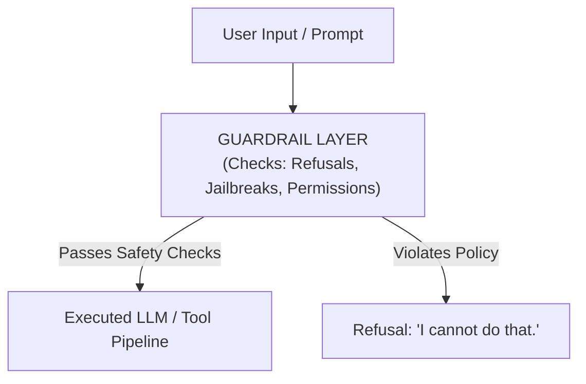

# 🛡️ AI Security, Evals & Observability

> **Series:** AI Engineer Series  
> **Topic:** Most Imp For Any AI Engineer Interview (AI Security, Evals & Observability)  
> **Lecturer:** Pratyush (Padho with Pratyush)  
> **Source:** [Watch on YouTube](http://www.youtube.com/watch?v=5byRqd6mLs0)

---

## 📑 Table of Contents

- [1. Executive Summary & Core Context](#1-executive-summary--core-context)
- [2. Pillar 1: Evals (Evaluation)](#2-pillar-1-evals-evaluation)
  - [2.1 Definition & Purpose](#21-definition--purpose)
  - [2.2 Operational Mechanics & Examples](#22-operational-mechanics--examples)
  - [2.3 The Cricket Match Analogy](#23-the-cricket-match-analogy)
- [3. Pillar 2: Observability](#3-pillar-2-observability)
  - [3.1 Definition & Purpose](#31-definition--purpose)
  - [3.2 The Cricket Match Analogy](#32-the-cricket-match-analogy)
  - [3.3 The 3 Core Building Blocks of Observability](#33-the-3-core-building-blocks-of-observability)
- [4. Pillar 3: Guardrails](#4-pillar-3-guardrails)
  - [4.1 Definition & Purpose](#41-definition--purpose)
  - [4.2 Threat Scenarios & Mitigations](#42-threat-scenarios--mitigations)
  - [4.3 Realistic Security Boundary](#43-realistic-security-boundary)
- [5. ⚡ Quick Revision Summary](#5--quick-revision-summary)
- [6. ❓ Questions Raised by Lecturer](#6--questions-raised-by-lecturer)
- [7. 📖 Definitions (From Video Only)](#7--definitions-from-video-only)

---

## 1. Executive Summary & Core Context

In AI engineering interviews, building applications (RAG systems, Agentic workflows, MCP servers, LangGraph pipelines) represents only half of the required knowledge. The second, highly tested domain is **AI Security, System Reliability, and Evaluation**.

AI Security and System Quality rely on **3 core pillars**:

1. **Evals (Evaluation)**
2. **Observability**
3. **Guardrails**

---

## 2. Pillar 1: Evals (Evaluation)

### 2.1 Definition & Purpose

* **Evals** (short for Evaluation) refer to macro-level suite metrics used to measure whether an AI system performs correctly across a predefined set of test cases.
* It answers the overarching binary question: **"Is the system working as expected overall?"**

### 2.2 Operational Mechanics & Examples

* **Coding Agent Example:** Supplying 15 distinct bug-fixing tasks to a coding agent. If the agent successfully resolves all 15 bugs, the Eval metric confirms system health. If it only fixes 10, the Eval flags an issue for investigation.
* **Cost Anomalies:** Evals catch macro-level execution defects, such as a coding agent resolving a single minor bug at an exorbitant API cost of ₹1,00,000.

### 2.3 The Cricket Match Analogy

* **Eval = Final Match Scoreboard:** *"India won by 15 runs"* or *"India lost by 15 runs"*. It gives the final outcome without revealing turn-by-turn details.

---

## 3. Pillar 2: Observability

### 3.1 Definition & Purpose

* **Observability** provides granular, component-level, or step-by-step visibility into how an AI system arrived at an answer, where performance bottlenecked, or why a failure occurred.

### 3.2 The Cricket Match Analogy

* **Observability = Over-by-Over & Ball-by-Ball Analysis:** Showing that a match was lost specifically in the 14th over (when 3 wickets fell) or the 15th over (when 36 runs were conceded).

### 3.3 The 3 Core Building Blocks of Observability

| Observability Component | Scope | Definition & Contained Data Points |
| :--- | :--- | :--- |
| **Log** | Single-line event entry | A basic timestamped text entry indicating a specific discrete event (e.g., `[10:00 AM] LLM API Call Initiated`). |
| **Span** | Execution of **1 single call** | Captures 5 mandatory metrics for an isolated LLM call or Python tool call:<br><br>1. **Input:** Prompt payload or tool parameters.<br>2. **Output:** Generated LLM text or function return data.<br>3. **Token Usage / Cost:** Number of input/output tokens used and financial cost.<br>4. **Latency:** Execution time taken in seconds/milliseconds.<br>5. **Error Status:** Exceptions, failure stack traces, or success flags. |
| **Trace** | Full multi-step task lifecycle | The complete, chronologically stitched sequence of **all Spans** combined for a single task execution (e.g., User prompt $\rightarrow$ LLM Call 1 $\rightarrow$ Tool Call 1 $\rightarrow$ Tool Call 2 $\rightarrow$ Final LLM Response). |

---

## 4. Pillar 3: Guardrails

### 4.1 Definition & Purpose

* **Guardrails** are safety boundaries, programmatic policies, and validation checks embedded into an AI system to restrict the model from performing unsafe, malicious, unauthorized, or illegal operations.
* **Analogy:** Highway fencing on mountain roads or handrails on staircases to keep vehicles and pedestrians from falling over edges.

### 4.2 Threat Scenarios & Mitigations



```text
                  ┌──────────────────────────────────────────────┐
                  │              User Input / Prompt             │
                  └──────────────────────┬───────────────────────┘
                                         │
                                         ▼
                  ┌──────────────────────────────────────────────┐
                  │               GUARDRAIL LAYER                │
                  │  Checks: Refusals, Jailbreaks, Permissions   │
                  └──────┬────────────────────────────────┬──────┘
                         │                                │
            [Passes Safety Checks]               [Violates Policy]
                         │                                │
                         ▼                                ▼
         ┌──────────────────────────────┐  ┌──────────────────────────────┐
         │ Executed LLM / Tool Pipeline │  │ Refusal: "I cannot do that." │
         └──────────────────────────────┘  └──────────────────────────────┘
```

* **Prompt Injection Defense:** Prevents external prompts from hijacking an agent to execute destructive commands (e.g., a prompt instructing a coding agent to `delete Windows system directory`).
* **Content Moderation:** Blocks generation of explicit, harmful, or NSFW content (e.g., ChatGPT refusing requests to strip clothing from photos).
* **Cybersecurity & Malicious Intent Restrictions:** Prevents misuse for unauthorized penetration testing or hacking scripts (e.g., Claude refusing to generate exploit scripts for IRCTC servers, even when framed under "learning", "educational", or "hackathon" excuses).
* **Action Authorisation Checkpoints:** Forces explicit human confirmation before executing sensitive filesystem or environment changes.

### 4.3 Realistic Security Boundary

* Guardrails are **not 100% foolproof**.
* Intelligent adversarial prompts (jailbreaking) can occasionally bypass safety layers, but writing comprehensive, context-aware guardrail policies significantly elevates system security and prevents basic exploits.

---

## 5. ⚡ Quick Revision Summary

1. AI Security and System Reliability consist of **3 main pillars**: Evals, Observability, and Guardrails.
2. **Evals** provide macro-level correctness metrics across test suites (Answers: "Did the system pass overall?").
3. **Observability** provides step-by-step diagnostics (Answers: "Where specifically did an error occur?").
4. Observability comprises **Logs** (single line event), **Spans** (single call lifecycle metrics), and **Traces** (full chain of all spans).
5. Every **Span** tracks 5 metrics: Input, Output, Token/Cost, Latency, and Error Status.
6. **Guardrails** act as security policy rails preventing model abuse, malicious command execution, and prompt injections.
7. Adversarial excuses (e.g., "for educational/hackathon purposes") must be hard-coded into guardrail policies to prevent security bypasses.

---

## 6. ❓ Questions Raised by Lecturer

### Q1: What is the main structural difference between a Span and a Trace in AI Observability?
> **Answer:** A **Span** records 5 performance metrics for a *single* step/call (an isolated LLM call or tool execution), while a **Trace** is the aggregated sequence of *all* Spans generated across an entire end-to-end task execution.

### Q2: Why are Guardrails necessary if an AI system already has strong Evals?
> **Answer:** Evals only measure whether an agent produces correct output for expected inputs. Guardrails actively block unexpected malicious inputs (e.g., prompt injection, file deletion commands, or generation of exploit code) in real time before execution.

---

## 7. 📖 Definitions (From Video Only)

| Term | Definition |
| :--- | :--- |
| **Evals (Evaluation)** | System-level testing metrics used to evaluate overall accuracy, failure rates, and execution cost across benchmark test cases. |
| **Observability** | Detailed monitoring infrastructure that records logs, spans, and traces to pinpoint component failures and performance bottlenecks. |
| **Log** | A single timestamped text line recording an event occurrence. |
| **Span** | A telemetry record capturing Input, Output, Cost/Tokens, Latency, and Error status for a single operational step. |
| **Trace** | The complete collection of connected spans representing an end-to-end multi-step AI workflow. |
| **Guardrails** | Rules, validation scripts, and security filters enforcing boundaries on LLM inputs and outputs to prevent harmful or unauthorized execution. |