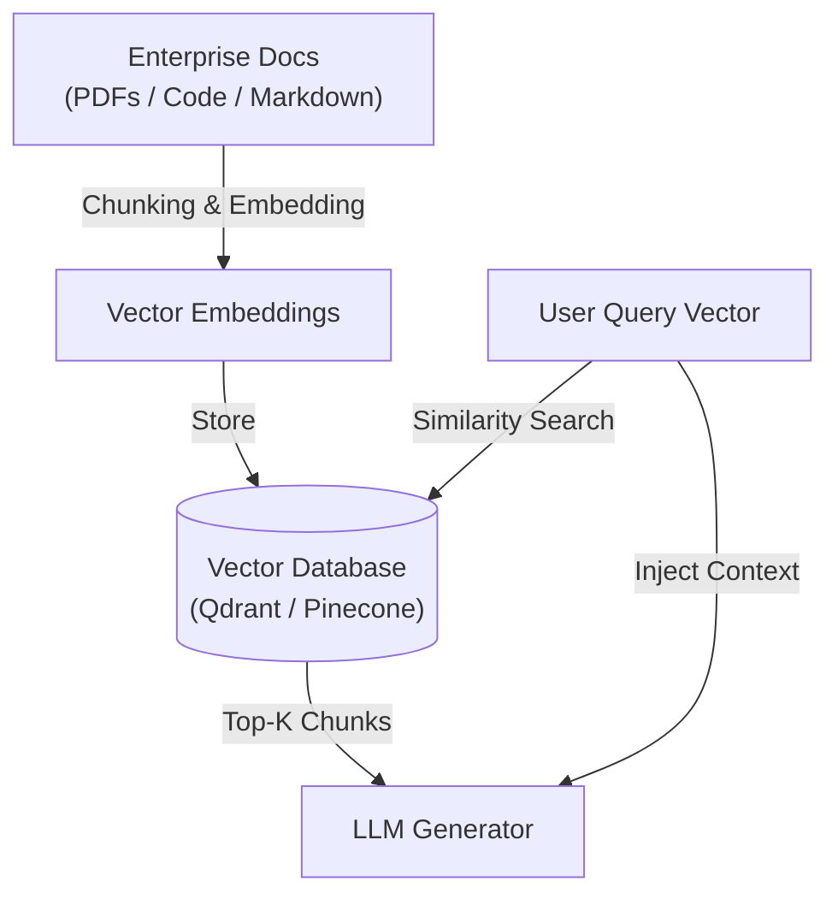

# 🚀 AI Concepts Revision for AI Engineer Interviews

> **Series:** AI Engineer Series  
> **Topic:** Watch This Before Any AI Engineer Interview | AI Concepts Revision  
> **Lecturer:** Pratyush (Padho with Pratyush)  
> **Source:** [Watch on YouTube](http://www.youtube.com/watch?v=sPounA3bkJk)

---

## 📑 Table of Contents

- [1. LLM Core Mechanics & Probabilistic Next-Token Prediction](#1-llm-core-mechanics--probabilistic-next-token-prediction)
  - [1.1 Fundamental Definition](#11-fundamental-definition)
- [2. First LLM API Call & Response Parameter Control](#2-first-llm-api-call--response-parameter-control)
  - [2.1 Basic API Integration](#21-basic-api-integration)
  - [2.2 Generation Control Parameters](#22-generation-control-parameters)
- [3. Prompt Message Roles & Context Memory Management](#3-prompt-message-roles--context-memory-management)
  - [3.1 Role Definitions](#31-role-definitions)
  - [3.2 Context Window](#32-context-window)
- [4. Temperature Parameter & Output Variance](#4-temperature-parameter--output-variance)
- [5. Tokenization Mechanics & Mathematical Representation](#5-tokenization-mechanics--mathematical-representation)
  - [5.1 Token Definition](#51-token-definition)
  - [5.2 Tokenization Pipeline](#52-tokenization-pipeline)
- [6. Structured Outputs: Pydantic & JSON Schema Validation](#6-structured-outputs-pydantic--json-schema-validation)
  - [6.1 Unstructured Text vs. Structured JSON](#61-unstructured-text-vs-structured-json)
  - [6.2 Industry Necessity](#62-industry-necessity)
- [7. Prompt Engineering: The 6-Step Robust Prompt Framework](#7-prompt-engineering-the-6-step-robust-prompt-framework)
- [8. ReAct Paradigm & Autonomous AI Agents](#8-react-paradigm--autonomous-ai-agents)
  - [8.1 The ReAct Paradigm](#81-the-react-paradigm)
  - [8.2 AI Agent Definition](#82-ai-agent-definition)
- [9. Streaming Generation & UI/UX Latency Optimization](#9-streaming-generation--uiux-latency-optimization)
  - [9.1 Technical Mechanics](#91-technical-mechanics)
  - [9.2 The Airport Baggage Carousel UX Analogy](#92-the-airport-baggage-carousel-ux-analogy)
- [10. Retrieval-Augmented Generation (RAG) Architecture](#10-retrieval-augmented-generation-rag-architecture)
  - [10.1 Core Problem](#101-core-problem)
  - [10.2 End-to-End RAG Architecture](#102-end-to-end-rag-architecture)
- [11. RAG Evaluation & The 3 Primary Failure Modes](#11-rag-evaluation--the-3-primary-failure-modes)
- [12. LangGraph Framework & Multi-Agent State Graph Architecture](#12-langgraph-framework--multi-agent-state-graph-architecture)
  - [12.1 Purpose](#121-purpose)
  - [12.2 Core Graph Primitives](#122-core-graph-primitives)
- [13. Model Context Protocol (MCP)](#13-model-context-protocol-mcp)
  - [13.1 Creator & Core Concept](#131-creator--core-concept)
  - [13.2 The API Breaking Change Problem & Solution](#132-the-api-breaking-change-problem--solution)
  - [13.3 The Zomato Analogy](#133-the-zomato-analogy)
- [14. The AI Security & Reliability Trinity: Evals, Observability, and Guardrails](#14-the-ai-security--reliability-trinity-evals-observability-and-guardrails)
  - [14.1 Evals (Evaluation)](#141-evals-evaluation)
  - [14.2 Observability](#142-observability)
  - [14.3 Guardrails](#143-guardrails)
- [15. Comprehensive Revision Summary Matrix](#15-comprehensive-revision-summary-matrix)

---

## 1. LLM Core Mechanics & Probabilistic Next-Token Prediction

### 1.1 Fundamental Definition

* A **Large Language Model (LLM)** is a statistical probabilistic model trained on massive internet corpora to predict the most likely subsequent token based on an input sequence.
* **Not a "Truth Machine":** LLMs do not inherently understand absolute truth or falsehood. They output responses based purely on token probability distributions derived from their training data.
* *Example:* For the calculation $2 + 2$, the model outputs $4$ because the statistical probability of "$4$" following "$2 + 2 =$" in its training data approaches ~90%+, not because the model possesses biological consciousness or raw mathematical understanding.

---

## 2. First LLM API Call & Response Parameter Control

### 2.1 Basic API Integration

* Programmatic calls to LLM endpoints (e.g., using the Groq API) send HTTP payloads containing prompt text and configuration parameters.

### 2.2 Generation Control Parameters

* Developers control the model's output via explicit parameters in the API call payload:
  * **`max_tokens` / Word Caps:** Restricts minimum and maximum output length (e.g., constraining output to under 50 words vs. multi-page responses).
  * **Stop Sequences:** Defines specific characters or tokens that force the LLM to cease generation immediately.

---

## 3. Prompt Message Roles & Context Memory Management

When dispatching requests to a chat-based LLM endpoint, messages are structured into three distinct roles:

```text
┌──────────────────────────────────────────────────────────┐
│                      SYSTEM ROLE                         │
│  "You are a Senior HR Interviewer conducting a technical  │
│   interview. Maintain this persona throughout."          │
└────────────────────────────┬─────────────────────────────┘
                             │
┌────────────────────────────▼─────────────────────────────┐
│                      ASSISTANT ROLE                      │
│  Memory log of past model responses maintaining          │
│  multi-turn conversation continuity.                     │
└────────────────────────────┬─────────────────────────────┘
                             │
┌────────────────────────────▼─────────────────────────────┐
│                        USER ROLE                         │
│  Direct user inputs and active prompt queries.            │
└──────────────────────────────────────────────────────────┘
```

### 3.1 Role Definitions

1. **System Role:** Sets the overarching persona, operating rules, behavioral boundaries, and system constraints across the entire session.
   * *Example:* "You are an experienced HR interviewer. Maintain this persona across all turns and do not deviate."
2. **User Role:** Contains the direct prompt query or payload sent by the user during the active turn.
3. **Assistant Role:** Stores historical responses generated by the LLM in previous turns, allowing the model to reference past context during multi-turn interactions.

### 3.2 Context Window

* **Definition:** The maximum token capacity allocated for storing conversation history in an LLM call session (e.g., Claude 3.5 Opus with a 1M token context window).
* **Context Loss:** When conversation length exceeds the context window capacity, older tokens are truncated, causing the LLM to "forget" earlier details.

---

## 4. Temperature Parameter & Output Variance

The **Temperature** parameter controls randomness, creativity, and token sampling probability distributions.

$$\text{Low Temperature } (T \to 0) \iff \text{Deterministic / Standardized Outputs}$$

$$\text{High Temperature } (T \to 1.0 - 2.0) \iff \text{Creative / High-Variance Outputs}$$

| Setting | Operational Behavior | Ideal Use Cases |
| :--- | :--- | :--- |
| **$T = 0.0$** | Selects only the highest-probability tokens (Greedy Decoding). High determinism and consistency. | Medical diagnosis agents (e.g., prescribing standard drugs like Paracetamol), coding assistants, math solvers, and JSON extraction. |
| **$T = 1.0 - 2.0$** | Flattens token probability distributions, allowing lower-probability tokens to be sampled. Introduces unpredictability and creative variance. | Brainstorming, creative writing, and generating unusual brand names (e.g., suggesting eccentric names like *"Zomato"*). |

---

## 5. Tokenization Mechanics & Mathematical Representation

### 5.1 Token Definition

* Humans process natural language text via words; LLMs process **Tokens** (sub-word text fragments mapped to numerical IDs).

### 5.2 Tokenization Pipeline

```text
Raw Text Input ("Pratyush") ──► Tokenizer Split ("PRAT" + "USH") ──► Integer IDs ──► Vector Embeddings / Tensors
```

* A word is split into sub-word byte pairs (e.g., `"Pratyush"` $\to$ `["PRAT", "USH"]`).
* **General Rule of Thumb:** $1\text{ Token} \approx 0.75\text{ Words}$ (or $\frac{3}{4}$ of a word).

---

## 6. Structured Outputs: Pydantic & JSON Schema Validation

### 6.1 Unstructured Text vs. Structured JSON

* **Unstructured Text:** Natural language paragraphs suitable for direct human reading.
* **Structured JSON:** Key-value data dictionaries designed for programmatic consumption by downstream software services.

```json
{
  "name": "Pratyush",
  "occupation": "Software Engineer 2",
  "experience_years": 3
}
```

### 6.2 Industry Necessity

* Downstream application code (Python, Java, C++) cannot reliably parse free-form text paragraphs to extract quantitative variables.
* Utilizing Pydantic schemas forces LLM outputs into deterministic JSON format, enabling direct programmatic attribute retrieval (e.g., `json.fetch("experience_years")` returning integer `3`).

---

## 7. Prompt Engineering: The 6-Step Robust Prompt Framework

A robust prompt contains 6 key structural components to eliminate ambiguity and maximize response accuracy:

```text
┌──────────────────────────────────────────────────────────┐
│          6-Step Robust Prompt Architecture               │
├──────────────────────────────────────────────────────────┤
│ 1. Core Task Requirement & Scope                         │
│ 2. Explicit Output Format Declaration (e.g., JSON schema)│
│ 3. Persona / Role Definition                             │
│ 4. Domain Context & Background                           │
│ 5. Few-Shot Example Outputs                              │
│ 6. Fallback Rules & Edge Case Handling Instructions      │
└──────────────────────────────────────────────────────────┘
```

* **Poor Prompt:** *"Write a research paper."*
* **Robust Prompt:** *"Act as an Academic Researcher. Write an IEEE-formatted paper on AI security. Follow this provided JSON schema, review these 2 reference examples, and if information is missing, output 'DATA_UNAVAILABLE'."*

---

## 8. ReAct Paradigm & Autonomous AI Agents

### 8.1 The ReAct Paradigm

* **ReAct** stands for **Reasoning + Action**.

### 8.2 AI Agent Definition

$$\text{AI Agent} = \text{LLM Orchestrator} + \text{Functional Tool Access}$$

* **Base LLM:** Limited to text input in and text output out.
* **AI Agent:** Equipped with API tool access (Calculators, Flight Search APIs, Database Queries, Payment Gateways) to autonomously execute end-to-end real-world workflows.

#### Execution Workflow Example (Flight Booking):

1. **User Request:** *"Book a flight from Delhi to Mumbai under my ₹2,000 budget."*
2. **Step 1 (Reasoning):** LLM determines it needs flight prices and account balance.
3. **Step 2 (Action):** Calls `web_search_tool` $\to$ retrieves flight prices.
4. **Step 3 (Action):** Calls `bank_balance_tool` $\to$ verifies available funds.
5. **Step 4 (Action):** Calls `calculator_tool` $\to$ computes net cost.
6. **Step 5 (Action):** Invokes `paytm_booking_api` $\to$ completes ticket purchase.

---

## 9. Streaming Generation & UI/UX Latency Optimization

### 9.1 Technical Mechanics

* **Streaming** delivers output chunks incrementally as tokens are generated, rather than blocking execution until the full document is completed.

### 9.2 The Airport Baggage Carousel UX Analogy

* **Problem:** At airports, baggage unloader processes take 8–10 minutes. When the baggage carousel was placed right next to the arrival gate, passengers walked over in 1 minute and stood idle for 8 minutes, leading to complaints about "slow service".
* **Solution:** Airport management extended the walking terminal route to take 10 minutes. Passengers spent those 10 minutes actively walking; by the time they reached the carousel, baggage was already waiting. Overall processing time remained unchanged, but customer satisfaction soared because **idle waiting time was eliminated**.
* **LLM UI Parallel:** Token streaming gives users immediate text chunks to read, keeping the user engaged while long responses generate in the background.

---

## 10. Retrieval-Augmented Generation (RAG) Architecture

### 10.1 Core Problem

* Public LLMs lack access to private enterprise documents, proprietary repositories, or real-time internal HR policies.

### 10.2 End-to-End RAG Architecture



```text
┌────────────────────┐      Chunking &      ┌─────────────────────┐
│ Enterprise Docs    ├─────────────────────►│ Vector Embeddings   │
│ (PDFs/Code/Markdown)│      Embedding      └──────────┬──────────┘
└────────────────────┘                                 │ Store
                                                       ▼
┌────────────────────┐    Vector Similarity ┌─────────────────────┐
│ User Query Vector  ├─────────────────────►│ Vector Database     │
└─────────┬──────────┘         Search       │ (Qdrant / Pinecone) │
          │                                 └──────────┬──────────┘
          │ Inject Context                             │ Top-K Chunks
          └───────────────────►┌───────────────────────▼──┐
                               │     LLM Generator        │
                               └──────────────────────────┘
```

1. **Knowledge Base Ingestion:** Internal enterprise documents (PDFs, Markdown, source code) are parsed.
2. **Chunking & Embedding:** Text chunks are transformed into dense vector embedding arrays.
3. **Vector Database Storage:** Vector arrays are stored in a specialized vector database (e.g., Qdrant, Pinecone).
4. **Similarity Retrieval:** Incoming user queries are embedded into vectors; a cosine similarity search retrieves the Top-$K$ relevant context chunks.
5. **Context Augmentation:** Retrieved context chunks are injected into the LLM system prompt to generate accurate, grounded answers.

---

## 11. RAG Evaluation & The 3 Primary Failure Modes

RAG systems are benchmarked against **Golden Datasets** (curated reference test cases of queries and expected answers).

```text
┌──────────────────────────────────────────────────────────┐
│                 RAG 3 Failure Points                     │
├──────────────────────────────────────────────────────────┤
│ 1. Knowledge Base Defect (Inaccurate / outdated source)  │
│ 2. Retrieval Failure (Vector DB returns irrelevant chunks)│
│ 3. LLM Generation Failure (LLM misreads correct context) │
└──────────────────────────────────────────────────────────┘
```

1. **Failure Mode 1: Knowledge Base Defect** $\to$ Source documentation itself contains inaccurate or outdated facts.
2. **Failure Mode 2: Retrieval Failure** $\to$ Vector DB returns irrelevant chunks (e.g., user asks about a stomach ache, but vector search retrieves headache policies).
3. **Failure Mode 3: LLM Generation / Reading Failure** $\to$ Vector DB successfully retrieves the correct context chunk (e.g., context specifies *Combiflam*), but the LLM hallucinates or misreads it (e.g., outputting *Dolo*).

---

## 12. LangGraph Framework & Multi-Agent State Graph Architecture

### 12.1 Purpose

* Standard linear scripts collapse when orchestrating complex workflows with 20,000+ tools or multi-agent branching loops. LangGraph models workflows as directed state graphs.

### 12.2 Core Graph Primitives

* **State:** A shared global memory whiteboard accessible across all graph nodes.
* **Nodes:** Execution functions, LLM calls, or tool scripts.
* **Edges:** Directed connections defining routing logic and conditional transitions between nodes.

---

## 13. Model Context Protocol (MCP)

### 13.1 Creator & Core Concept

* Released by **Anthropic** in 2024 as an open protocol standardizing how LLMs communicate with external tools.

### 13.2 The API Breaking Change Problem & Solution

* **Traditional Setup:** If a tool vendor (e.g., Tavily Search) updates its API parameters from 2 arguments to 3, LLM wrapper code breaks until developers push a new software release.
* **MCP Standard:** Tool providers host an **MCP Server**. The LLM queries the MCP Server dynamically to discover available tools and parameter schemas on the fly, rendering integration immune to API updates.

### 13.3 The Zomato Analogy

* **Zomato = MCP Server Platform**
* **Restaurants = Tool Providers**
* **Hungry Customer = LLM Client**
* If *Biryani Place* changes prices from ₹300 to ₹350, it updates its menu on Zomato. Customers interact with the standardized Zomato interface without taking custom ordering courses for every individual restaurant.

---

## 14. The AI Security & Reliability Trinity: Evals, Observability, and Guardrails

```text
┌──────────────────────────────────────────────────────────┐
│               AI Security & Reliability                  │
├────────────────────────────┬─────────────────────────────┤
│ 1. Evals                   │ Macro-level binary success  │
│                            │ metrics (Pass / Fail)       │
├────────────────────────────┼─────────────────────────────┤
│ 2. Observability           │ Micro-level telemetry:      │
│                            │ Logs, Spans, Traces         │
├────────────────────────────┼─────────────────────────────┤
│ 3. Guardrails              │ Real-time safety filters &  │
│                            │ authorization boundaries    │
└────────────────────────────┴─────────────────────────────┘
```

### 14.1 Evals (Evaluation)

* **Macro-level binary testing** measuring whether a system succeeds or fails overall across test suites.
* *Cricket Match Analogy:* **Match Result** (*"India lost by 15 runs"*).

### 14.2 Observability

* **Micro-level execution telemetry** providing ball-by-ball, step-by-step diagnostic visibility:
  * **Log:** Single-line event timestamp.
  * **Span:** Detailed performance metrics for 1 single call (Input payload, Output payload, Token/Cost, Latency, Error status).
  * **Trace:** The aggregated chronological chain of all spans across a task lifecycle.
* *Cricket Match Analogy:* **Over-by-over analysis** showing that the match was lost specifically in the 13th over (Rohit Sharma wicket) or 17th over (36 runs conceded).

### 14.3 Guardrails

* Security policies, input filters, and permission boundaries designed to prevent prompt injection, system command execution (e.g., commands attempting to `delete Windows system directory`), NSFW generation, or illegal hacking script creation.
* **Adversarial Security Reality:** Guardrails are not 100% bypass-proof (social engineering / jailbreak prompts can occasionally trick models), but comprehensive guardrails drastically reduce risk profiles.

---

## 15. Comprehensive Revision Summary Matrix

| Architecture / Concept | Primary Function | Key Problem Solved | Real-World Analogy / Benchmark |
| :--- | :--- | :--- | :--- |
| **LLM Engine** | Probabilistic Next-Token Prediction | Natural language processing | $2+2=4$ statistical probability (~90%+) |
| **Temperature ($T$)** | Controls output sampling randomness | Fixed vs. creative output generation | $T=0$: Paracetamol prescription<br><br>$T=1.5$: "Zomato" brand naming |
| **Tokenization** | Maps text to sub-word integer IDs | Bridges natural language to math vectors | 1 Token $\approx$ 0.75 Words |
| **Pydantic / JSON** | Forces structured key-value output | Downstream code integration | `json.fetch("experience_years")` |
| **ReAct AI Agent** | Orchestrates LLM + External Tool APIs | Autonomous task execution | Flight booking via search + Paytm API |
| **Streaming UI** | Transmits token chunks incrementally | Eliminates idle user wait time | Airport 10-minute terminal walk |
| **RAG System** | Vector search over private enterprise data | Bypasses knowledge cutoffs & public limits | Qdrant vector database similarity search |
| **LangGraph** | Models workflows as state graphs | Scalability for 20,000+ complex tools | Global state whiteboard + Nodes + Edges |
| **MCP Protocol** | Open standard for LLM-to-tool connections | Third-party API breaking changes | Zomato connecting diners to restaurant menus |
| **Evals** | Macro system testing across benchmarks | Overall system health verification | Cricket Match Scoreboard (Win/Loss) |
| **Observability** | Step-by-step diagnostic telemetry | Pinpointing exact call failure points | Over-by-over score breakdown (Logs/Spans/Traces) |
| **Guardrails** | Real-time safety validation filters | Prompt injection & system abuse defense | Highway fencing on mountain roads |