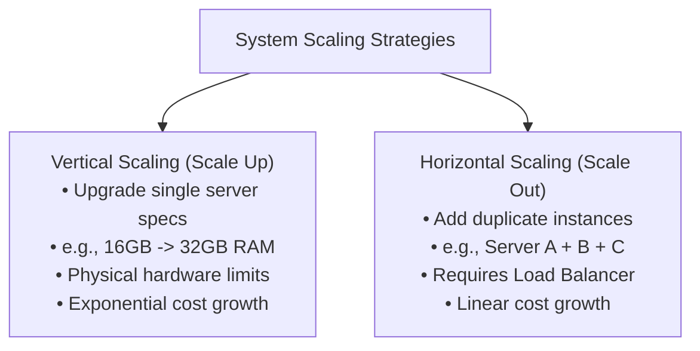
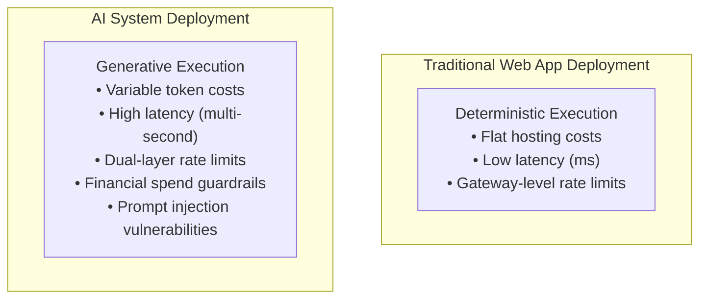

# 🚀 Deployment Explained Like Never Before

> **Series:** AI Engineering Series  
> **Topic:** Deployment Explained Like Never Before  
> **Lecturer:** Pratyush (Padho with Pratyush)  
> **Source:** [Watch on YouTube](http://www.youtube.com/watch?v=gZT-ApWAw84)

---

## 📑 Table of Contents

- [1. Fundamentals of Deployment in Software Engineering](#1-fundamentals-of-deployment-in-software-engineering)
  - [1.1 Limitations of Local Machine Development](#11-limitations-of-local-machine-development)
- [2. Cloud Data Centers & Server Infrastructure](#2-cloud-data-centers--server-infrastructure)
  - [2.1 Key Characteristics of Cloud Servers](#21-key-characteristics-of-cloud-servers)
- [3. System Scaling Strategies: Vertical vs. Horizontal](#3-system-scaling-strategies-vertical-vs-horizontal)
  - [3.1 Horizontal Scaling Challenges](#31-horizontal-scaling-challenges)
- [4. Traditional Software Deployment vs. AI Engineering Deployment](#4-traditional-software-deployment-vs-ai-engineering-deployment)
  - [4.1 The Vending Machine vs. Chef Analogy](#41-the-vending-machine-vs-chef-analogy)
  - [4.2 Key Differentiators in AI System Deployment](#42-key-differentiators-in-ai-system-deployment)
- [5. ⚡ Quick Revision Summary](#5--quick-revision-summary)
- [6. ❓ Questions Raised by Lecturer](#6--questions-raised-by-lecturer)
- [7. 📖 Definitions (From Video Only)](#7--definitions-from-video-only)

---

## 1. Fundamentals of Deployment in Software Engineering

Deployment is the architectural process of migrating code from a local developer machine (laptop) to enterprise-grade cloud servers (data centers managed by providers like Google Cloud, AWS, Microsoft Azure, or Akamai) that run continuously.

### 1.1 Limitations of Local Machine Development

* **Hardware Constraints:** Personal computers have fixed CPU cores (e.g., 8-core CPUs) and RAM limits (e.g., 8 GB, 16 GB, 24 GB, or up to 32 GB for high-end gaming laptops).
* **Localhost Process Dependence:** Local development servers rely on active terminal processes (e.g., running `npm run dev` or `python main.py`). Terminating the process (`Ctrl + C`) destroys server accessibility.
* **Uptime & Power Dependencies:** Local machines require uninterrupted 24/7 electricity, active cooling, and continuous home internet connectivity.
* **Concurrency Bottlenecks:** While a local setup can handle a single developer testing locally, serving thousands or millions of simultaneous concurrent user requests will exhaust memory and crash the machine.

---

## 2. Cloud Data Centers & Server Infrastructure

Cloud deployment moves application execution to high-spec server hardware housed inside industrial data centers.

### 2.1 Key Characteristics of Cloud Servers

* **Public IP Address & DNS Mapping:** Cloud instances are assigned static public IP addresses linked via Domain Name System (DNS) to public URLs (e.g., `google.com`).
* **Guaranteed 24/7 Uptime:** Data centers feature redundant power generators, liquid/industrial air cooling, and high-speed multi-fiber internet connections, reducing downtime.
* **High-Capacity Hardware Specs:** Enterprise servers house multi-socket CPUs and massive memory configurations (e.g., enterprise Dell server rigs featuring 256-core CPUs and 1 Terabyte of RAM).
* **Hardware Cost Structures:** Cloud providers charge subscription fees scaling with requested hardware allocation (e.g., a 16-core / 32 GB RAM instance costs moderately, while a 256-core / 1 TB RAM instance incurs steep operational expenses).

---

## 3. System Scaling Strategies: Vertical vs. Horizontal

When incoming traffic exceeds server capacity, systems must be scaled using one of two primary architectural approaches:



```text
                     ┌──────────────────────────┐
                     │     Scaling Options      │
                     └────────────┬─────────────┘
                                  │
         ┌────────────────────────┴────────────────────────┐
         ▼                                                 ▼
┌───────────────────────────┐             ┌───────────────────────────┐
│   Vertical Scaling        │             │   Horizontal Scaling      │
│   (Scale Up)              │             │   (Scale Out)             │
├───────────────────────────┤             ├───────────────────────────┤
│ Upgrade single server     │             │ Add duplicate instances   │
│ (e.g., 16GB -> 32GB RAM)  │             │ (e.g., Server A + B + C)  │
│ Hardware limits apply     │             │ Requires Load Balancer    │
│ Exponential cost growth   │             │ Linear cost growth        │
└───────────────────────────┘             └───────────────────────────┘
```

| Feature / Metric | Vertical Scaling (Scale Up) | Horizontal Scaling (Scale Out) |
| :--- | :--- | :--- |
| **Core Mechanism** | Upgrading CPU and RAM capacity on the existing single server instance. | Deploying multiple identical server instances alongside each other. |
| **Real-World Analogy** | Adding more tables, waiters, and kitchen equipment into one restaurant building. | Opening duplicate branch locations of the same restaurant across different sites. |
| **Cost Trajectory** | **Exponential cost curve:** Doubling server hardware specs increases pricing disproportionately. | **Linear cost curve:** Adding a second identical ₹10,000 instance equals ₹20,000 total. |
| **System Ceiling** | Limited by physical ceiling limits of maximum available server hardware. | Theoretically unlimited scaling capacity by continuously adding nodes. |
| **Architectural Challenges** | Minimal software changes required. | Requires **Load Balancers** to route traffic and **State Sync** mechanisms across instances. |

### 3.1 Horizontal Scaling Challenges

* **Load Balancing:** A central router (Load Balancer) must sit in front of the server pool to distribute user requests evenly and prevent single-instance overloads.
* **State & Data Synchronization:** Multi-instance architectures must synchronize shared session states, databases, and cached data across separate physical nodes.

---

## 4. Traditional Software Deployment vs. AI Engineering Deployment

Deploying AI-native systems (LLMs, Agentic workflows, RAG pipelines) introduces unique operational constraints compared to traditional web applications.

### 4.1 The Vending Machine vs. Chef Analogy

* **Traditional Software = Vending Machine:** Deterministic logic. Inserting coins and selecting an option instantly dispenses a pre-packaged output with negligible compute latency.
* **AI System = Skilled Chef:** Generative logic. Customers place custom dish orders, requiring the chef to process and prepare the output dynamically.



```text
┌─────────────────────────────────────────────────────────────┐
│                 Traditional Web App Deployment              │
│  (Flat compute cost, low latency, deterministic execution)  │
└──────────────────────────────┬──────────────────────────────┘
                               │
┌──────────────────────────────▼──────────────────────────────┐
│                    AI System Deployment                     │
│  (Variable token cost, high latency, prompt injection risk) │
└─────────────────────────────────────────────────────────────┘
```

### 4.2 Key Differentiators in AI System Deployment

1. **High Per-Request Latency:**
   * Traditional database queries return results in milliseconds.
   * LLM generation steps and agent tool iterations introduce multi-second processing latency per interaction.

2. **Variable Per-User Token Costs:**
   * Traditional apps incur static server hosting costs regardless of user volume growth.
   * AI deployments incur variable, linear costs for every prompt and response token processed by the LLM provider API.

3. **Natural Language Security Attack Vectors:**
   * Traditional software is compromised via code vulnerabilities, SQL injections, or server exploits.
   * AI systems can be exploited by non-technical users through plain-text **Prompt Injections**, **Jailbreaks**, or unauthorized execution prompts.

4. **Dual-Layer Rate Limiting:**
   * Traditional apps maintain rate limiting only at the API gateway layer.
   * AI applications must enforce gateway-level rate limits while managing upstream LLM provider API rate limits (e.g., Groq or OpenAI TPM/RPM caps) to prevent service dropouts.

5. **Hard Financial Spending Guardrails:**
   * Production AI deployments require strict daily/monthly spending caps (e.g., capping daily API spend at ₹1,00,000).
   * Spending guardrails prevent financial loss from infinite agent loop bugs or denial-of-wallet attacks.

6. **API Key Security:**
   * Upstream LLM provider keys (Groq, OpenAI, Gemini) must never be embedded in client-side bundles or public code repositories.
   * Keys must be stored securely in server-side environment configurations (`.env`).

---

## 5. ⚡ Quick Revision Summary

1. **Deployment** moves code from a local developer environment to high-spec, continuously running cloud servers.
2. **Local Machine Limits:** 8–32 GB RAM, fixed CPU cores, terminal process dependency, and inability to handle concurrent user spikes.
3. **Data Centers:** Provide static public IP addresses, DNS domain mapping, 24/7 power/cooling redundancy, and enterprise hardware (e.g., 256-core CPUs, 1 TB RAM).
4. **Vertical Scaling (Scale Up):** Upgrades hardware capacity on a single instance; costs scale **exponentially** and hit physical hardware limits.
5. **Horizontal Scaling (Scale Out):** Deploys multiple server nodes side-by-side; costs scale **linearly** but require **Load Balancing** and **State Sync**.
6. **Traditional Apps vs. AI Systems:** Vending Machine analogy (fast, deterministic, flat hosting cost) vs. Chef analogy (generative, latency-heavy, token cost per request).
7. **AI Deployment Essentials:** Managing high latency, variable token costs, natural language prompt injection risks, dual-layer rate limits, hard financial spending caps, and secure server-side API key management.

---

## 6. ❓ Questions Raised by Lecturer

### Q1: Why is horizontal scaling preferred over vertical scaling for large production applications?
> **Answer:** Vertical scaling incurs exponential cost growth and hits physical server limits. Horizontal scaling provides linear cost growth and theoretically infinite capacity by continuously adding duplicate nodes behind a Load Balancer.

### Q2: Why do AI applications require hard financial spending caps during deployment?
> **Answer:** Unlike traditional software with fixed server hosting costs, AI systems incur token-based API charges per request. If an agent enters an infinite execution loop or faces a malicious traffic burst, API spend can rapidly spike into massive costs overnight without hard daily caps.

---

## 7. 📖 Definitions (From Video Only)

| Term | Definition |
| :--- | :--- |
| **Deployment** | The engineering process of uploading code from a local environment to cloud servers to make it accessible to public users 24/7. |
| **Vertical Scaling (Scale Up)** | Increasing the CPU, RAM, or storage specifications of a single existing server instance. |
| **Horizontal Scaling (Scale Out)** | Adding multiple identical server instances running in parallel to share incoming traffic loads. |
| **Load Balancer** | A networking component that routes incoming user requests evenly across multiple horizontal server instances. |
| **Dual-Layer Rate Limiting** | Restricting request rates at both the application gateway level and the upstream LLM provider API level. |
| **Financial Spending Guardrail** | A hard daily or monthly budget cap configured on cloud or LLM provider accounts to block requests once budget thresholds are reached. |